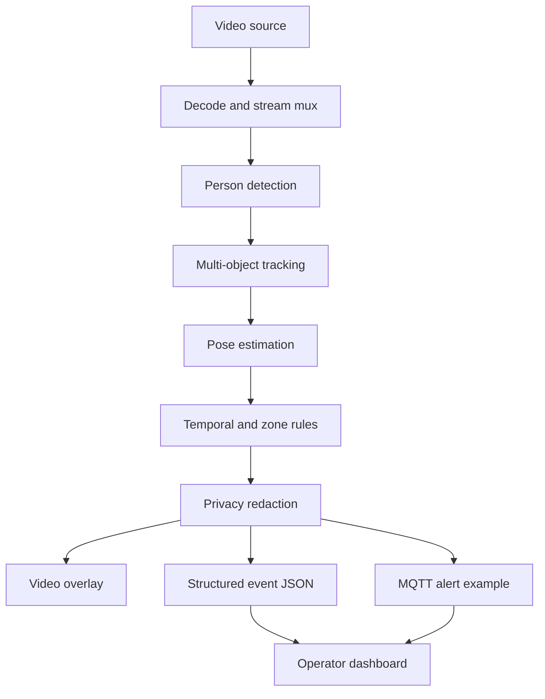

# 🛡️ AegisVision
### Privacy-conscious industrial safety monitoring — a PipeGen hackathon prototype

<p align="center">
  <strong>From passive CCTV to clearer safety signals.</strong><br/>
  A concept dashboard for worker-fall and hazard-zone event monitoring at the edge.
</p>

<p align="center">
  
  
  
  
  
</p>

> **Prototype status — please read:** The Streamlit dashboard runs as a scenario-based demonstration. Its incident rows and MQTT/JSON examples are simulated. The live DeepStream/PipeGen pipeline, camera inference, MQTT delivery, privacy processing, and performance figures have **not been verified end-to-end**. The DeepStream image download failed during setup in the current environment. Do not treat this prototype as a real machinery safety system.

---

## 👥 Team & submission details

- **Team name:** sync4ce
- **Team members:** Namita Maruti Sherakhane, Naguru Kethan Kumar Reddy, Kuntimaddi Joshika, and Manya Agarwal
- **Event:** CraftifAI Physical AI Buildathon — HackWithBangalore 4.0
- **Track:** Track A — PipeGen (v0.5.1) / Perception
- **Participant ID:** CRA004
- **Institution:** PES University, Bengaluru
- **Project:** AegisVision — Privacy-Conscious Industrial Safety Monitoring

### Team skills & focus areas

| Team member | Skills / focus area |
|---|---|
| **Namita Maruti Sherakhane** | Python, Streamlit dashboard development, scenario-based UI, project integration, and demo/documentation coordination |
| **Naguru Kethan Kumar Reddy** | Python development, perception-pipeline research, and integration planning for the proposed PipeGen/DeepStream workflow |
| **Kuntimaddi Joshika** | Industrial safety use-case research, hazard/fall scenario design, and event-flow requirements |
| **Manya Agarwal** | UI/UX review, dashboard presentation, documentation, and buildathon demo preparation |

*These are project-aligned focus areas for the team, not claims of independently verified expertise. The current repository implements a scenario-based dashboard prototype; live perception, PipeGen/DeepStream execution, MQTT delivery, and privacy processing remain unverified.*

## ✨ What is AegisVision?

Factories use cameras to observe busy work areas, but a camera feed alone does not turn a potential hazard into a structured, actionable event. AegisVision explores a possible edge-AI workflow for:

- **Fall-event scenarios** — represent a worker posture held over a time threshold.
- **Hazard-zone scenarios** — represent a worker entering a configured restricted area.
- **Privacy-aware design** — plan for on-device redaction before incident footage is stored.
- **Structured alerts** — show example JSON/MQTT event payloads for a future integration.
- **Operator dashboard** — present scenarios, an event table, a proposed pipeline topology, and reported optimization figures with verification caveats.

The current UI is a **prototype/demo**, not a validated detector or a safety-certified control system.

## 🖥️ Demo dashboard

The dashboard is built with Streamlit and includes:
- Scenario selector for normal operation, zone intrusion, and fall-event examples
- A sample event log clearly labelled as simulated
- Example alert payload for integration planning
- A pipeline topology sketch
- A performance table that preserves the figures shown in the demo while explicitly labelling them unverified

**Live dashboard:** https://craftifaihackathoncra004-9uappcdkxn9sqebz7mkukyg.streamlit.app/  
**Prototype walkthrough:** The 89-second demo video is intended to be supplied as the video URL in the submission form. Upload it to an accessible host (for example, YouTube as Unlisted or Google Drive with link access) and paste that share link into the form. The video demonstrates the dashboard scenarios and displayed interface; it should not be interpreted as independent proof of a live PipeGen/DeepStream inference run unless that execution is visibly shown and reproducible.

## 🧱 Intended architecture



This diagram describes the **intended design**, not a verified running pipeline. The planned stack references NVIDIA DeepStream, TensorRT, PipeGen, and MQTT. Those integrations remain unverified in this repository's current demo.

## 🚀 Run the dashboard locally

### Requirements
- Python 3
- Git
- A terminal

### Setup

```bash
git clone https://github.com/NamitaMS/CraftifAIHackathon_CRA004.git
cd CraftifAIHackathon_CRA004

python3 -m venv .venv
source .venv/bin/activate
python -m pip install --upgrade pip
python -m pip install streamlit pandas
streamlit run aegis_dashboard.py
```

Open the local URL Streamlit prints (usually `http://localhost:8501`).

> This starts the dashboard demo only. It does **not** install PipeGen or run a DeepStream inference pipeline.

## 🧪 What is implemented vs. planned?

| Component | Current status |
|---|---|
| Streamlit dashboard | Implemented; local launch tested |
| Scenario selector and simulated event table | Implemented |
| Example JSON/MQTT payload display | Implemented as simulated output |
| Pipeline topology sketch | Documentation/demo only |
| Live camera input and inference | Not verified |
| PipeGen-generated pipeline execution | Not verified |
| FPS/latency values shown in the demo | Visible in the UI/video; measurement method and live pipeline origin not verified |\n| TensorRT FP32/FP16/INT8 benchmarking | Figures shown are not independently verified as reproducible benchmarks |
| MQTT broker delivery or machinery control | Not connected / not verified |
| Privacy redaction on real frames | Not verified |

## 📊 Performance claims

The demo UI visibly displays figures including 142.8 FPS and 3.40 ms/frame. The video confirms that these numbers appear in the interface, but does not by itself establish the measurement method, hardware/configuration, or that they came from a live end-to-end PipeGen/DeepStream run. Treat them as **unverified displayed figures**, not validated benchmark results.

## 🛠️ Current limitation

During PipeGen startup, the download of `craftifaidocker/deepstream:7.1-amd64-v3` failed with a connection reset. Registry endpoints were reachable, but the large image transfer did not complete. As a result, the end-to-end pipeline and video output remain unverified.

## 👥 Team sync4ce

- **Namita Maruti Sherakhane**
- **Naguru Kethan Kumar Reddy**
- **Kuntimaddi Joshika**
- **Manya Agarwal**

**Event:** CraftifAI Physical AI Buildathon — HackWithBangalore 4.0  
**Track:** Track A — PipeGen (v0.5.1) / Perception  
**Participant ID:** CRA004  
**Institution:** PES University, Bengaluru

## 🔭 Next steps

1. Complete the DeepStream image download and verify PipeGen startup on supported hardware.
2. Build and run a minimal video pipeline before adding analytics.
3. Connect a real video source and validate event logic.
4. Verify privacy processing on actual frames.
5. Test MQTT delivery against a broker, without connecting to real machinery during development.
6. Measure latency, throughput, power, and accuracy with reproducible commands and publish the test environment/results.

---

*Built as a hackathon prototype. Any future deployment involving worker safety or machinery must undergo proper validation, fail-safe design, and safety review.*

## 🎬 60-second judge walkthrough

1. **Start with the problem:** busy industrial zones need clear, reviewable safety signals—not just another camera feed.
2. **Show Scenario 1:** establish the normal-operation baseline.
3. **Switch to Scenario 2:** explain how a configured zone-boundary event could be surfaced to an operator.
4. **Switch to Scenario 3:** explain the illustrative posture-duration threshold and the need for a human/site-approved response.
5. **Show the event log and JSON preview:** point out how a future integration could carry a track identifier, zone, event label, timestamp/frame example, and proposed action in a structured format.
6. **Close with privacy and validation:** explain that edge processing and redaction are design goals; live inference and redaction are not yet verified in this prototype.

**Demo narration:** “AegisVision explores how an edge-AI safety pipeline could turn video analytics into structured, reviewable events. This dashboard lets us walk through normal operation, restricted-zone entry, and a fall-event example. The event table and JSON payload are simulated to demonstrate the operator experience and an integration contract. Our next validation milestone is to run the DeepStream pipeline end-to-end, measure it reproducibly, and verify privacy processing and broker delivery before making any real-world safety claims.”

## 🧭 Design principles

- **Human review first:** alerts are intended to support trained operators, not replace site safety procedures.
- **Privacy by design:** local processing and redaction are planned design goals; they are not claimed as implemented.
- **Fail honestly:** unavailable integrations are labelled as unverified rather than represented as live.
- **No unsafe actuation:** example actions are display-only; this demo does not connect to or control machinery.
- **Reproducibility:** performance numbers should only be promoted to measured results when test hardware, model, configuration, and benchmark output are recorded.

## 🗺️ Validation roadmap

| Milestone | Evidence required |
|---|---|
| 1. Runtime | DeepStream/PipeGen container starts successfully on supported hardware |
| 2. Video path | A sample video passes through the pipeline and produces inspectable output |
| 3. Event logic | Documented zone and posture-duration rules are tested against labelled examples |
| 4. Privacy | Redaction is visually checked on representative frames before storage/export |
| 5. Messaging | A test MQTT broker receives a sample event; no machinery endpoint is involved |
| 6. Benchmark | Repeatable latency/FPS/power measurements with environment and configuration recorded |

